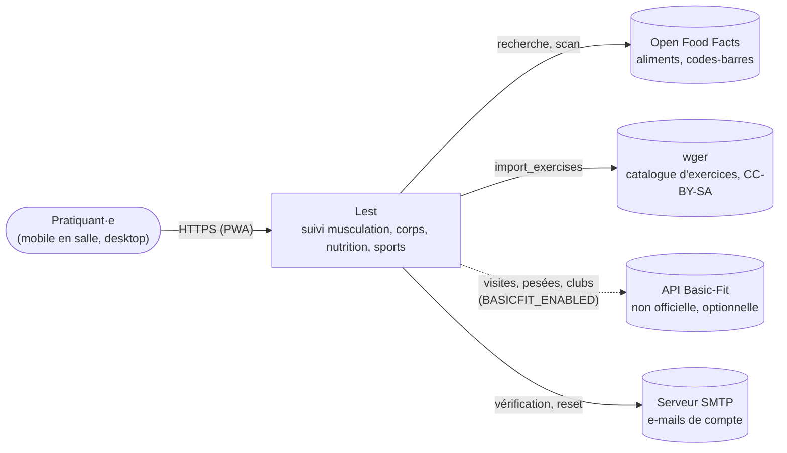
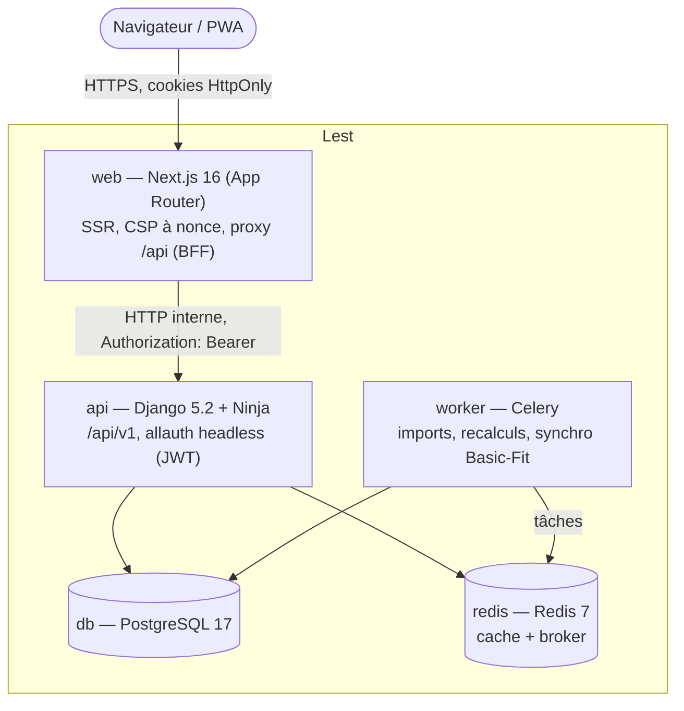

# Architecture

Vue d'ensemble selon le modèle [C4](https://c4model.com) : contexte (niveau 1) puis conteneurs
(niveau 2). Les décisions structurantes sont dans [`adr/`](adr/).

## Niveau 1 — Contexte

## Niveau 2 — Conteneurs

| Conteneur | Responsabilité | Code |
| --- | --- | --- |
| `web` | Pages, rendu serveur, en-têtes de sécurité, **seul point d'entrée du navigateur** ; garde les jetons côté serveur (ADR 0001) | `frontend/` |
| `api` | Règles métier (`services`), lectures (`selectors`), API Ninja mince ; une app par domaine | `backend/` |
| `worker` | Traitements asynchrones et planifiés | `backend/` (Celery) |
| `db` | Données ; filtrage par propriétaire systématique | — |
| `redis` | Cache et file de tâches | — |

## Flux d'une requête

1. Le navigateur appelle `https://…/api/v1/…` sur la **même origine** que les pages.
2. `web` (route `/api/[...path]`) n'autorise que `/api/v1/*`, filtre les en-têtes et relaie vers `api`.
3. `api` authentifie (Phase 1), délègue aux `services` et `selectors`, et répond en JSON, ou en
   `application/problem+json` (RFC 9457) en cas d'erreur.

## Environnements

| | Dev (`just up`) | CI (E2E) | Prod (à venir) |
| --- | --- | --- | --- |
| Images | cible `dev`, code synchronisé (`develop.watch`) | cible `prod` (`compose.e2e.yaml`) | cible `prod` |
| Serveurs | `runserver`, `next dev` | gunicorn, Next standalone | gunicorn, Next standalone |
| CSP | assouplie (`unsafe-eval` pour React dev) | stricte | stricte |
